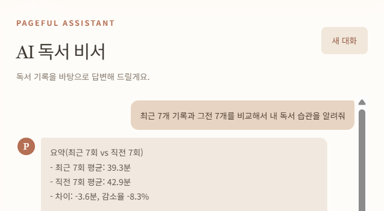
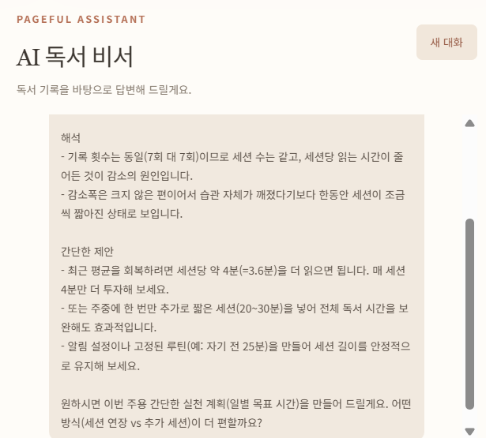
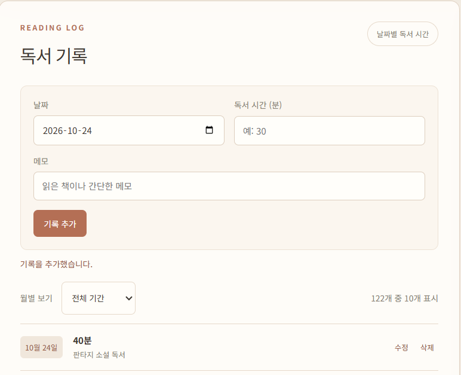
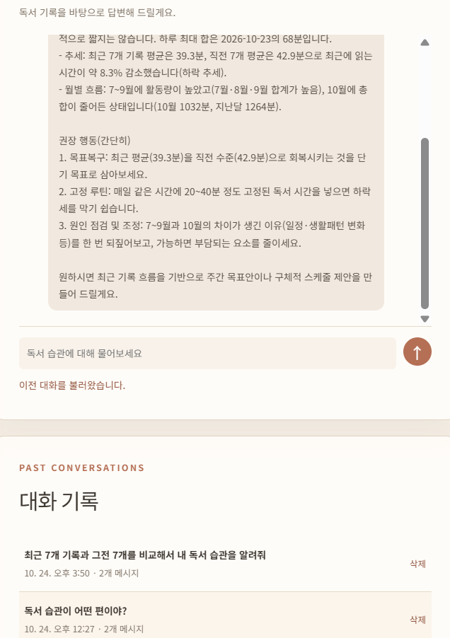

# Pageful — AI 독서 습관 비서

Pageful은 날짜별 독서 시간(분)을 기록하고, 평균·최대·최소·최근 추세를 분석해 개인화된 AI 답변을 제공하는 웹 앱입니다. 과제의 핵심 흐름은 **시계열 기록 → Firestore 저장 → 요약 계산 → 시스템 프롬프트 주입 → GPT 답변**입니다.

GitHub 저장소: https://github.com/codyssey-seungmin/M1-2

## 기술 스택

| 영역 | 기술 |
|---|---|
| 백엔드 | Python 3.10+, FastAPI, Uvicorn, Pydantic |
| 데이터베이스·인증 | Firebase Firestore, Firebase Authentication 익명 인증, Firebase Admin SDK |
| AI | OpenAI Python SDK: 공식 Responses API 또는 코디세이 OpenAI 호환 Chat Completions |
| 프론트엔드 | HTML, CSS, Vanilla JavaScript, Firebase Web 인증 모듈 |
| 정적 빌드 | esbuild (프레임워크 아님) |
| 배포 | Render(백엔드), Vercel(프론트엔드) |

## 주요 기능

- 날짜·독서 시간·메모 기록 추가, 조회, 수정, 삭제
- 독서 기록 목록은 최신 10개부터 표시하고, 월별 필터와 10개씩 더 보기 제공 (요약 계산은 전체 기록 기준). 같은 날짜는 입력 시각이 늦은 기록부터 표시
- 기록 기간, 개수, 총합, 평균, 최대·최소, 최근 7개 기록의 추세 요약
- 실제 최근 7일 독서 시간을 표시하는 그래프
- 요약 정보를 시스템 프롬프트에 넣는 AI 채팅
- 대화 자동 저장, 목록 조회, 이전 대화 불러오기, 삭제
- 로그인 화면 없이 Firebase 익명 인증으로 사용자별 데이터 분리
- AI 요청 중 로딩 표시와 Render 첫 요청 지연 안내
- 세로형 스마트폰 화면에 맞춘 한 열 배치와 읽기 쉬운 입력·채팅 UI

## 데이터 구조

```text
data/{uid}/records/{recordId}
  date: "2026-10-20"
  value: 35                 # 독서 시간, 분
  memo: "책과 메모"
  created_at, updated_at

conversations/{uid}/items/{conversationId}
  title: "최근 독서 습관은?"
  messages: [{role: "user", content: "..."}, {role: "assistant", content: "..."}]
  created_at, updated_at
```

브라우저는 Firebase 익명 로그인 후 받은 ID 토큰을 FastAPI에 전달합니다. FastAPI는 토큰을 검증하고 해당 `uid` 경로만 읽고 씁니다. 브라우저가 Firestore에 직접 접근하지 않도록 [firestore.rules](firestore.rules)는 직접 읽기·쓰기를 거부합니다. Admin SDK는 보안 규칙을 우회하므로 실제 사용자 분리는 백엔드의 토큰 검증과 `uid` 경로 선택에 달려 있습니다.

Firestore 규칙은 [firebase.json](firebase.json)에 연결해 `pageful-bb7e2` 프로젝트의 기본 데이터베이스에 배포했습니다. 별도 브라우저에서는 다른 익명 UID와 기록 0개가 표시됐고, 시험용 익명 사용자 토큰으로 백엔드의 기록·요약·대화 API를 호출해 모두 0개임을 확인했습니다. 같은 토큰으로 기존 사용자의 Firestore 문서를 직접 읽으면 HTTP 403 `PERMISSION_DENIED`가 반환됐습니다. 이 검증은 기존 121개 기록을 변경하지 않았습니다.

익명 계정은 보통 같은 브라우저 프로필에서 유지됩니다. 브라우저 데이터를 지우거나 다른 기기로 이동하면 기존 기록을 복구할 로그인 수단이 없습니다. Firebase 프로젝트 관리자 권한이 있다면 저장 데이터를 확인할 수 있으므로 과제용 테스트 데이터를 사용하세요.

## API

모든 `/api/*` 요청에 `Authorization: Bearer <Firebase ID token>` 헤더가 필요합니다.

| 방식 | 경로 | 기능 |
|---|---|---|
| POST | `/api/data` | 기록 추가 |
| GET | `/api/data` | 기록 목록 |
| PUT | `/api/data/{id}` | 기록 수정 |
| DELETE | `/api/data/{id}` | 기록 삭제 |
| GET | `/api/data/summary` | 기간·통계·추세 조회 |
| POST | `/api/conversations` | 대화 저장 |
| GET | `/api/conversations` | 대화 목록 |
| GET | `/api/conversations/{id}` | 전체 메시지 불러오기 |
| DELETE | `/api/conversations/{id}` | 대화 삭제 |
| POST | `/api/chat` | AI 답변과 대화 자동 저장 |

`GET /health`는 배포 상태 확인용입니다. `GET /docs`에서 Swagger UI를 볼 수 있습니다. 입력 오류는 Pydantic의 422 응답 또는 앱의 400 응답으로 전달됩니다. 인증 실패는 401, 없는 기록은 404, AI 제공자 오류는 502, Firestore API 오류는 503과 사용자용 안내 문구로 전달됩니다.

### 독서 기록 예시

```json
{"date":"2026-10-20","value":35,"memo":"소설 20페이지"}
```

### 채팅 예시

```json
{"message":"최근 독서 습관이 좋아지고 있어?","conversation_id":null}
```

AI 요청 시 백엔드는 해당 사용자의 최신 독서 요약을 조회합니다. 최근 추세는 **최근 7개 기록과 직전 7개 기록의 평균**을 비교해 5% 이상 차이면 상승·하락, 그 외는 유지로 판정합니다. 질문은 최대 1,000자입니다. AI 응답 상한은 코디세이 연동 시 4000토큰, 공식 OpenAI 연동 시 400토큰입니다. 이는 최대치이지 모든 요청에서 해당 토큰을 사용한다는 뜻은 아닙니다. API 호출에는 비용이 발생할 수 있습니다.

기록 목록과 추세 계산은 날짜를 우선하고, 같은 날짜는 저장 시각(`created_at`) 순서를 사용합니다. 목록은 최신 기록부터, 추세 계산은 오래된 기록부터 처리합니다. 저장 시각이 없는 기존 과제용 기록은 문서 ID를 보조 기준으로 사용하므로 순서가 매번 바뀌지 않습니다.

### AI 제공자 선택

기본 `AI_PROVIDER=openai`는 공식 OpenAI `Responses API`를 사용합니다. 코디세이에서 발급한 가상 키를 사용하는 경우에는 아래처럼 프로젝트 루트의 **Git 제외된** `.env`에 설정합니다.

```dotenv
AI_PROVIDER=codyssey
CODYSSEY_BASE_URL=https://copa.codyssey.kr/v1
CODYSSEY_API_KEY=발급받은_가상_키
CODYSSEY_MODEL=코디세이에서_확인한_GPT_모델_ID
```

코디세이 주소는 백엔드의 OpenAI SDK에 `base_url`로 지정되어 `/v1/chat/completions`로 요청됩니다. 코디세이 모드에서는 `OPENAI_API_KEY`를 사용하지 않으므로 공식 OpenAI 키를 가상 키 칸에 넣지 마세요. `CODYSSEY_MODEL`은 코디세이에서 실제 지원하는 **GPT 모델**의 정확한 ID를 입력해야 합니다. 코디세이의 `테스트(OpenAI)` 화면만으로 모델 ID와 과제의 GPT 사용 충족 여부까지 확정할 수는 없으며, 실제 모델과 답변을 확인해야 합니다. 이 모드에서는 독서 데이터 요약과 질문이 코디세이 서버로 전송되므로 제공자의 데이터 처리 정책을 확인하세요. 키를 입력한 뒤 백엔드를 재시작하고, 채팅 답변·대화 자동 저장·새로고침 후 불러오기를 확인합니다.

로컬에서 코디세이 가상 키와 `gpt-5-mini` 설정으로 연결을 확인했습니다. 이어 Firestore에 저장된 121개 기록(과제용 가상 기록 120개 포함)의 요약을 넣어 한 번 질문했을 때 기록 수(121개)와 최근 7개 기록 평균(39.9분), 직전 7개 기록 평균(42.9분), 하락 추세를 반영한 답변을 받았습니다. 해당 질문·답변 2개 메시지가 Firestore의 사용자별 `conversations` 경로에 저장된 것도 확인했습니다. 브라우저의 대화 목록에서 해당 대화를 다시 불러오는 동작은 사용자가 확인했습니다.

## 사전 준비

1. Python 3.10 이상과 Node.js를 준비합니다.
2. Firebase 프로젝트를 만들고 Firestore Database를 활성화합니다.
3. Firebase Authentication의 **Anonymous** 로그인 방식을 활성화합니다.
4. Firebase Web 앱을 등록하고 공개 Web 설정값을 확인합니다.
5. Firebase 서비스 계정 키 JSON을 발급받습니다.
6. 공식 OpenAI 키 또는 코디세이 가상 키를 준비하고, 해당 제공자가 지원하는 GPT 모델 ID를 확인합니다.

서비스 계정 키와 AI API 키는 Git에 올리지 않습니다. `.gitignore`는 `.env`, 로컬 서비스 계정 파일과 가상환경을 제외합니다. Firebase Web 설정값은 브라우저에 전달되는 공개 설정이지만, 서비스 계정 JSON과 AI API 키는 절대 프론트엔드에 넣지 않습니다. 2026-10-24에 사용자가 AI API 키와 Firebase 서비스 계정 키를 새로 발급해 배포 설정에 반영했고, 서비스 정상 동작 및 이전 키 폐기를 확인했습니다.

## 로컬 실행 (Windows PowerShell)

프로젝트 루트에서 [`.env.example`](.env.example)을 복사해 `.env`를 만들고 값을 채웁니다. 로컬에서는 `FIREBASE_SERVICE_ACCOUNT_PATH`에 서비스 계정 JSON 파일의 절대 경로를 쓰는 편이 편합니다. Render에서는 `FIREBASE_SERVICE_ACCOUNT_JSON`에 JSON 전체를 환경변수로 입력할 수 있습니다. 두 값 중 하나만 사용합니다.

```powershell
python -m venv backend\.venv
backend\.venv\Scripts\python.exe -m pip install -r backend\requirements.txt
backend\.venv\Scripts\python.exe -m uvicorn main:app --app-dir backend --host 127.0.0.1 --port 8001
```

백엔드 확인: `http://127.0.0.1:8001/health`, Swagger: `http://127.0.0.1:8001/docs`

다른 터미널에서 프론트엔드를 빌드하고 실행합니다. Node.js 20 이상이면 `--env-file`로 루트 `.env`를 빌드에 적용할 수 있습니다.

```powershell
cd frontend
npm ci
node --env-file=../.env build.mjs
npm run dev
```

프론트엔드 주소: `http://127.0.0.1:5500`

프론트엔드는 순수 HTML/CSS/JavaScript입니다. esbuild는 Firebase 인증 모듈을 묶고 Vercel 환경변수를 정적 `config.js`에 넣는 용도로만 사용합니다. 프론트엔드 환경변수를 변경한 후에는 다시 빌드해야 합니다.

## 100개 이상 테스트 데이터

[backend/seed_data.py](backend/seed_data.py)는 오늘을 기준으로 120일치 **가상 독서 기록**을 생성합니다. 실제 독서 기록이 아니라 과제용 시연 데이터임을 명시해 사용하세요.

```powershell
backend\.venv\Scripts\python.exe backend\seed_data.py
```

위 명령은 개수와 기간만 미리 보여줍니다. 앱에서 익명 로그인이 완료된 뒤 오른쪽 위 `나` 버튼을 누르면 본인 UID가 표시됩니다. `ID 복사`를 누르거나 표시된 값을 직접 선택해 복사할 수 있습니다. 해당 브라우저의 기록으로 넣을 때만 다음 명령을 실행합니다.

```powershell
backend\.venv\Scripts\python.exe backend\seed_data.py --uid "복사한_UID" --apply
```

기존 `sample-날짜` 문서는 유지하며, 누락된 예시 기록만 추가합니다. 입력 후 앱을 새로고침하면 summary와 그래프에 반영됩니다.

로컬 연동 확인 시 Firestore에 과제용 예시 120개를 추가했고, 기존 기록 1개와 합쳐 총 121개 및 기간 2026-06-24 ~ 2026-10-21을 확인했습니다. 이 수치는 테스트 계정 기준이며 다른 익명 사용자에게는 보이지 않습니다.

배포 사이트의 시연용 익명 계정에도 같은 방식으로 예시 120개를 추가했습니다. 2026-10-23 확인 시 기존 수동 기록 1개를 포함해 총 121개, 기간 2026-06-26 ~ 2026-10-23입니다. 화면이나 제출 자료에는 120개가 실제 독서 이력이 아닌 **과제용 가상 데이터**임을 밝혀야 합니다. 다른 익명 계정에서는 이 기록이 보이지 않습니다.

## 테스트

```powershell
cd backend
.\.venv\Scripts\python.exe -m unittest discover -s tests -v
```

28개 백엔드 자동 테스트는 빈 데이터, 상승 추세, 120개 시계열 데이터, 같은 날짜의 입력 시각순 정렬·추세 계산, 입력 검증, 필수 API 경로, 토큰과 UID 사용, 기록 CRUD·대화 저장/불러오기/삭제의 모의 동작, AI 요약 주입·자동 저장, 코디세이 경로 및 공식 OpenAI 키와의 분리, 만료 토큰·AI 장애·Firestore 장애 응답을 확인합니다. 실제 HTTP에서는 인증 누락·무효 토큰 401, 잘못된 입력 400/422, 없는 기록 404를 확인했습니다. 로컬 브라우저에서 기록 추가·수정·삭제 및 새로고침 후 유지, AI 답변과 대화 불러오기는 사용자가 확인했습니다.

프론트엔드 목록 테스트는 `cd frontend` 후 `npm test`로 실행합니다. 121개 기록의 기본 10개 표시, 더 보기, 월별 필터, 선택한 월의 기록이 없어졌을 때 전체 기간 복귀를 확인합니다. 필터는 현재 불러온 목록의 화면 표시에만 적용되며 Firestore 기록이나 전체 요약 값은 바꾸지 않습니다.

### 모바일 화면 확인

세로형 화면 너비 320·360·390·430px에서 대시보드, 그래프, 독서 기록 입력, 채팅 배치를 브라우저 뷰포트로 확인했습니다. 가로 스크롤이 생기지 않도록 한 열 그리드를 적용하고, 좁은 화면에서는 그래프 제목과 단위 표시를 분리했습니다. 모바일 입력 글자는 16px로 두어 입력 시 자동 확대를 줄이고, 주요 버튼과 메뉴의 터치 영역을 키웠습니다. 실제 휴대전화 기기에서의 최종 확인은 아직 진행하지 않았습니다.

## 배포

### Render 백엔드

GitHub 저장소를 연결하고 루트의 [render.yaml](render.yaml) Blueprint를 사용하거나 Web Service에 다음을 입력합니다.

```text
Build: pip install -r backend/requirements.txt
Start: uvicorn main:app --app-dir backend --host 0.0.0.0 --port $PORT
```

Render 환경변수: 제공한 Blueprint는 현재 사용하는 코디세이 설정(`AI_PROVIDER=codyssey`, `CODYSSEY_BASE_URL`)을 기본값으로 두며, `CODYSSEY_API_KEY`, `CODYSSEY_MODEL`은 Render에서 직접 입력해야 합니다. 공식 OpenAI를 사용할 경우 `AI_PROVIDER=openai`로 바꾸고 `OPENAI_API_KEY`, `OPENAI_MODEL`을 직접 추가합니다. 두 경우 모두 `FIREBASE_SERVICE_ACCOUNT_JSON`, `ALLOWED_ORIGINS`(Vercel 도메인)가 필요합니다. 서비스 계정 JSON과 AI 키는 비밀 환경변수에 저장합니다. 배포 후 `/health`와 `/docs`를 확인합니다. 무료 티어를 쓰는 경우 첫 요청에 시간이 걸릴 수 있어 프론트엔드에 안내 문구가 있습니다.

121건의 시연 기록을 넣은 뒤 코디세이 `gpt-5-mini`가 1200토큰 한도에서 `finish_reason=length`와 빈 답변을 반환한 사례가 있었습니다. 이에 코디세이 응답 상한을 4000토큰으로 높였습니다. 추론 설정과 대화 맥락 구성은 변경하지 않았습니다. 변경 후 배포 사이트에서 사용자가 AI 답변이 정상 표시되고 새로고침 후에도 대화가 유지되는 것을 확인했습니다. 답변이 다시 비면 서버 로그에는 종료 사유와 토큰 수만 남기며, 질문·답변·키는 기록하지 않습니다. 과금 방지를 위해 테스트 요청은 필요한 만큼만 진행합니다.

### Vercel 프론트엔드

같은 GitHub 저장소를 연결하고 루트의 [vercel.json](vercel.json)을 사용합니다. `API_BASE_URL`에 Render API 주소를 입력하고, `FIREBASE_API_KEY`, `FIREBASE_AUTH_DOMAIN`, `FIREBASE_PROJECT_ID`, `FIREBASE_STORAGE_BUCKET`, `FIREBASE_MESSAGING_SENDER_ID`, `FIREBASE_APP_ID`를 Firebase Web 앱 설정값으로 입력합니다. 환경변수 수정 시 다시 빌드해 배포합니다.

Vercel 도메인을 Firebase Authentication의 승인된 도메인과 Render의 `ALLOWED_ORIGINS`에 추가합니다. Firestore 규칙은 이미 배포했으며, 규칙을 다시 배포할 때는 `firebase deploy --only firestore:rules --project pageful-bb7e2`를 사용합니다. 규칙 배포는 콘솔의 기존 규칙을 덮어쓰므로 수정 시 로컬 파일과 콘솔 내용을 함께 확인합니다.

배포 순서: GitHub에 코드 게시 → Render 백엔드 배포·`/docs` 확인(완료) → Vercel 프론트엔드 배포(완료) → 실제 Vercel 도메인을 Firebase 승인 도메인과 Render `ALLOWED_ORIGINS`에 등록(완료) → 배포 사이트에서 익명 인증·기록·채팅 재확인(사용자 확인). 제출 시연용 브라우저 계정에는 100개 이상 데이터가 준비되어 있고, 아래에 실제 배포 화면을 첨부했습니다.

## 배포 URL

| 항목 | URL |
|---|---|
| 프론트엔드 | https://pageful-web.vercel.app/ |
| 백엔드 API | https://m1-2-pw8w.onrender.com |
| Swagger UI | https://m1-2-pw8w.onrender.com/docs |

## 제출 스크린샷

실제 Vercel 배포 사이트에서 촬영했습니다. 첫 번째 요구 장면은 요약 수치와 AI 답변을 읽기 쉽도록 두 장으로 나눴습니다. 시연 데이터 중 120건은 과제용 가상 독서 기록입니다.

### 1. 데이터 요약을 반영한 AI 채팅

사용자 질문과 최근 7개·직전 7개 기록의 평균 및 추세가 답변에 반영된 장면입니다.



이어서 표시된 AI의 해석과 제안입니다.



### 2. 독서 기록 추가와 목록 갱신

기록 추가 완료 안내와 새로 추가된 40분 기록이 목록에 보입니다. 캡처 당시 전체 기록은 122건입니다.



### 3. 저장된 대화 불러오기

이전 대화를 선택한 뒤 저장된 답변이 다시 표시되고, 대화 목록과 불러오기 완료 안내가 보입니다.


